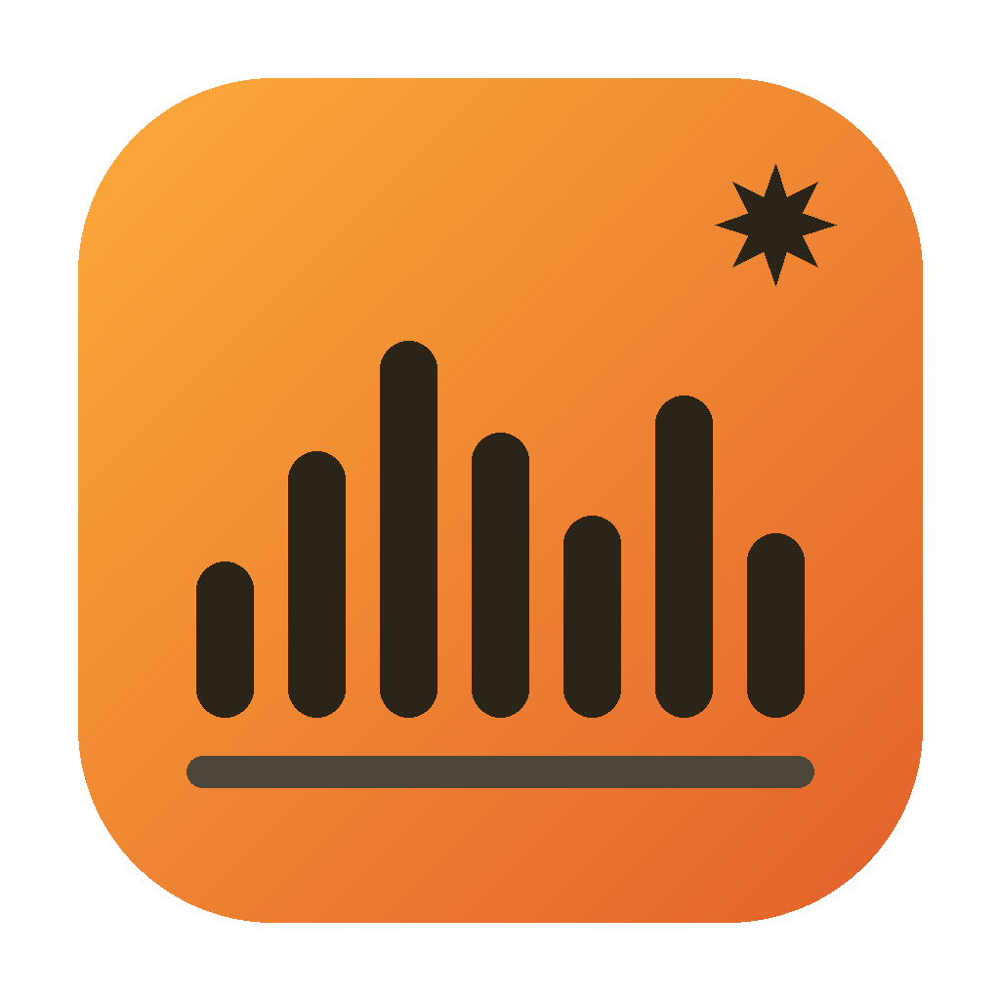
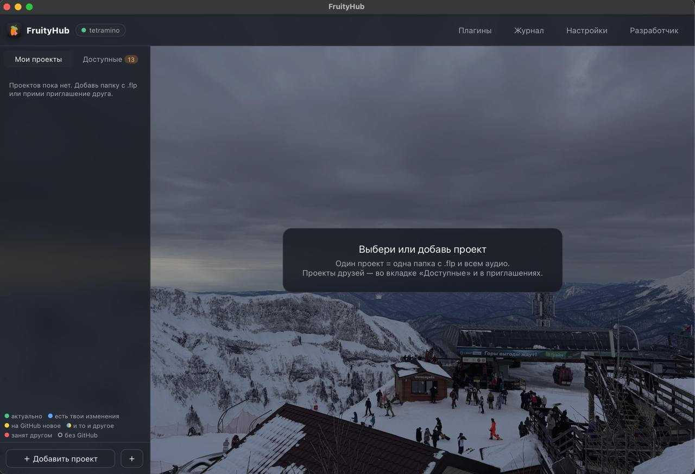
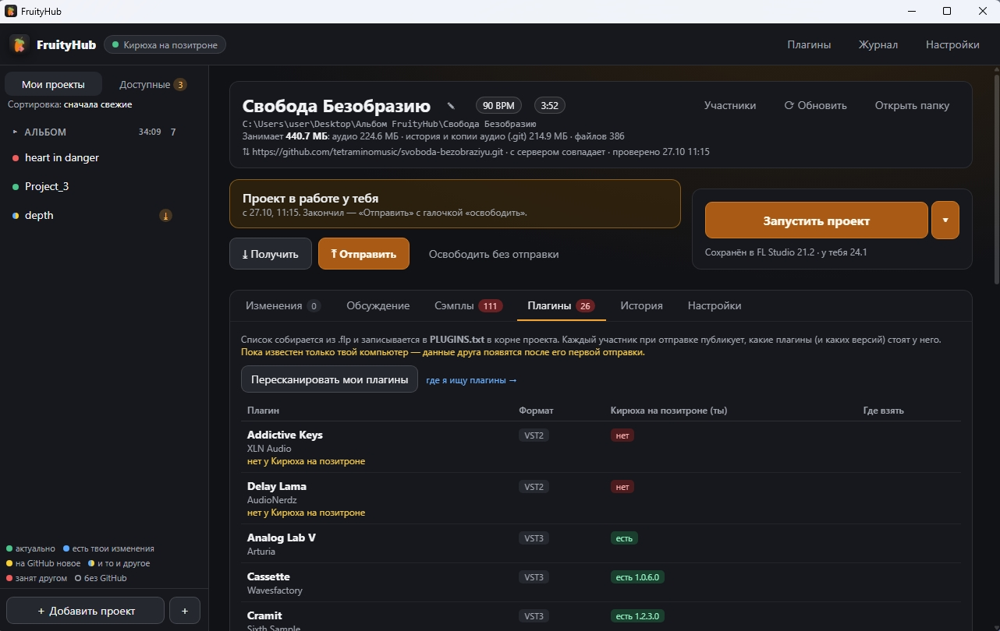

<p align="center">
  
</p>

<h1 align="center">FruityHub</h1>

<p align="center">
  <a href="LICENSE"></a>
  
  
  
  
  
</p>

<p align="center">Лаунчер, созданный для совместной работы над проектами Fl Studio на базе Git с полным переносом всех зависимостей проекта, будто плагины или аудиосэмплы.</p>

- [Структура приложения](#структура-приложения)
- [Особенности проекта](#особенности-проекта-вкратце)
- [Документация](#документация)
- [Пример интерфейса](#пример-интерфейса)
- [Сборки](#сборки)
- [Быстрый запуск](#быстрый-запуск)
- [Ограничения](#ограничения)
- [Лицензия](#лицензия)

## Структура приложения


Приложение частично представляет из себя абстрацию над GitHub, заточенную чисто под работу с музыкальными проектами. 

Хранение и обмен проектами происходит непосредственно через средства GitHub, достаточно создать [токен](https://github.com/settings/tokens) и приложение будет самостоятельно создавать репозитории для новых проектов, добавлять туда контрибуторов, а также заниматься перезаписью в git-истории бинарного файла проекта `.flp`.

__!! ВАЖНО !!__

Для организации обмена плагинами, аудиофайлов (если включена опция передачи аудиосэмплов напрямую без участия GitHub), хранения списка пользователей, а также хранение глобального состояния приложения и проектов используется [бекэнд](cmd/uzbek-server/), который вы самостоятельно поднимаете на своём сервере.

## Особенности проекта (вкратце)

* __Линкова аудиофайлов__, которые автоматически подгружаются в папку проекта, что исключает их потерю при переносе. Нет надобности создавать Zip Loop Package внутри Fl Studio. Все аудиосэмплы перемещаются в папку `Audio`.

* __Установка плагинов__ с компьютера участника проекта (требуется, чтобы приложение у участника было открыто), с переносом всех зависимостей и нужных библиотек. Доступа передача данных как через поднятый сервер, так и через локальную сеть, если устройства в оной находятся.

* __Проверка наличия или отсутствия плагинов__ для конкретного проекта вплоть до парсинга версии проекта из бинарника плагина.

* __Система пользователей и прав доступа__. Есть система приглашенией в проект, во время которого на стороне GitHub человек добавляется в качестве контрибутора. Владелец добавленного проекта может самостоятельно добавлять или убирать участников. Также каждому пользователю предоставляется возможность настроить доступ к установке с вашего устройка плагинов (начиная от разрешения каждого запроса, заканчивая полным доступом, главное, чтоб было открыто приложение). 

* __История версий__ проекта: любую прошлую версию можно достать копией и сразу открыть в FL Studio или откатить к ней весь проект целиком (.flp и аудио) — текущее состояние остаётся в истории, так что откат всегда можно отменить.

* __Cистема обсуждений и комментариев__ к конкретно каждому проекту, где можно записать текущий этап написания проекта, что можно добавить, что исправить, дабы не выносить это всё в ваши личные чаты.

* __Автоматическое добавление метаданных__ при рендере трека в папку проекта с добавлением обложки, имя артиста, названия трека и так далее.

## Документация

Особенности и плюшки проекта: [docs/features.md](docs/features.md). <br>

Всё о бекэнде, его возможностях и способе развёртывания: [docs/server.md](docs/server.md). <br>

Сборка и устройство кода: [docs/development.md](docs/development.md).


## Пример интерфейса

<p align="center">
  
</p>

<p align="center"><i>Главное меню приложения на Mac-OS.</i></p>
<br>
<p align="center">
  
</p>

<p align="center"><i>Меню выбранного проекта на Windows.</i></p>

Для новоиспечённых пользователей лаунчера при первом запуске будет встречать что-то в роде "обучения", объясняющее, как пользоваться приложением.


## Сборки

Готовые сборки можно найти в разделе [releases](../../releases):

| Платформа | Файл |
|---|---|
| Windows | `FruityHub-Windows.zip` (внутри `FruityHub.exe`) |
| Mac (M1–M4) | `FruityHub-mac-AppleSilicon.zip` |
| Mac (Intel) | `FruityHub-mac-Intel.zip` |
| Сервер (Linux VPS) | `uzbek-server.tar.gz` (ставится скриптом `deploy/server-up.sh`) |

Или же для самостоятельной сборки:

```
SERVER=<адрес> SERVER_CODE=<код> ./build.sh 0.9.1   # → dist/
```
Подробно — [docs/development.md](docs/development.md).


## Быстрый запуск

1. Поднятие сервера: `./deploy/server-up.sh root@<твой VPS>` (подробно — [docs/server.md](docs/server.md)).
2. Запуск FruityHub, где вы по началу вводите свой ник, Github-токен, адрес сервера и его код.
3. Добавление папки проекта в «Мои проекты», далее создания репозитория и приглашение нужных пользователей.
4. Другой пользователь запускает FruityHub, регистрируется, у него появляется приглашение, далее он нажимает «Принять и скачать».
5. Один раз в FL Studio обоим: *Options → File settings → Browser extra search folders* → папка со всеми проектами.

**Рабочий цикл:** 

- Получить
- Взять в работу
- Запустить проект
- работаешь в FL, Ctrl/⌘+S 
- Отправить (освободить)

Важно, что приложения не подписаны сертификатами разработчика, поэтому при первом запуске софта может вылезти предупреждение, мол, "доверять приложению" на Windows, а на Mac-Os может попросить доступ к документам и к музыке (для редактирования метаданных в аудиофайлах).

## Ограничения
* Бесплатный GitHub: **10 ГБ хранилища и 10 ГБ трафика Git LFS в месяц** на аккаунт владельца проектов.
* Плагин передаётся, только когда у обоих открыт FruityHub.
* Перетаскивание папки: окно приложения не сообщает, откуда папку перетащили, поэтому FruityHub ищет её на диске по имени и содержимому (несколько секунд). Если не нашёл — предложит выбрать вручную.

## Лицензия
[MIT](LICENSE) — код можно свободно использовать, изменять и распространять, сохранив строку об авторстве.

FruityHub — независимый проект, он не связан с Image-Line и не одобрен ею. FL Studio — товарный знак Image-Line Software.
